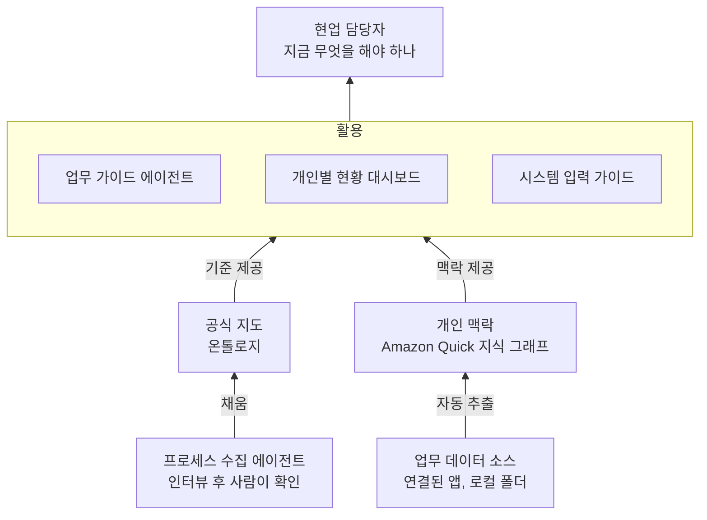

업무 프로세스를 AI로 어떻게 활용할지 논의하다가 떠올린 아이디어를 정리해 둔다. 개념 정리는 [Palantir 온톨로지(Ontology) 개념 정리]() 글에 따로 적었다.

## 1. 출발점: 프로세스를 배우는 게 아니라 실행하게 하기

논의에서 나온 방향은 이렇다.

- 복잡한 프로세스 맵을 그대로 교육하면 현업 담당자 부담이 크다. 더 단순하게 전달해야 한다.
- 현업 담당자는 프로세스를 **정의하는** 사람이 아니라 **실행하는** 사람이다. "지금 무엇을 해야 하는가"를 중심으로 안내해야 한다.
- 신규 입사자에게 거쳐야 할 업무 흐름, 시스템, 작업을 쉽게 알려주는 것이 중요하다.

이를 위해 나온 아이디어들을 일반화하면 다음과 같다.

| 아이디어 | 내용 |
|---|---|
| 프로세스 수집 에이전트 | AI가 프로세스 담당자를 인터뷰하고 양식에 맞춰 정리, 사람이 확인 후 등록 |
| 업무 가이드 에이전트 | 첫 건을 진행할 때 AI가 단계별로 질문하고 다음 할 일을 안내 |
| 개인별 현황 대시보드 | 담당자별 진행 건을 단계별로 보여주고, 합쳐서 전체 현황으로 확인 |
| 시스템 입력 가이드 | 신규 시스템 도입 시 역할별로 어느 시스템에 무엇을 입력하는지 정리 |

## 2. 내가 본 공통점

네 가지 아이디어는 결국 **같은 데이터를 쓰고, 쓰는 방향만 다르다.**

| 아이디어 | 데이터와의 관계 |
|---|---|
| 프로세스 수집 에이전트 | 프로세스를 **넣는** 쪽 |
| 업무 가이드 에이전트 | 진행 단계에 맞춰 **꺼내 쓰는** 쪽 |
| 개인별 현황 대시보드 | 건별 상태를 **모아 보는** 쪽 |
| 시스템 입력 가이드 | 역할·단계별 입력 시스템을 **조회하는** 쪽 |

그래서 이들을 하나로 엮는 연결 구조가 필요하다고 생각했다. 그 구조가 **사람·역할, 업무 단계, 시스템, 문서의 관계**를 정의한 온톨로지이고, 거기에 담당자 개인의 맥락을 붙이는 도구로 **Amazon Quick 지식 그래프**를 떠올렸다.

## 3. Amazon Quick 지식 그래프

Amazon Q Business 계열은 현재 **Amazon Quick**으로 개편됐고, 지식 그래프는 그 데스크톱 앱의 기능이다.

| 항목 | 내용 |
|---|---|
| **범위** | 사용자별 **개인** 그래프, 각자의 Amazon Quick 계정에 저장 |
| **플랫폼** | 데스크톱 앱 전용 |
| **데이터 소스** | 연결된 앱(자동 수집)과 폴더 단위로 지정한 로컬 파일 |
| **추출 대상** | 사람, 조직, 프로젝트, 이벤트, 커뮤니케이션, 문서, 액션, 의사결정, 용어 등 |
| **활용** | 프로젝트를 물으면 관련 사람, 최근 회의, 문서, 채널을 찾아 답변에 반영 |
| **관리** | 개체 이름·카테고리 수정, 개체 삭제, 그래프 전체 초기화 |

중요한 건 **사람이 정의한 스키마 없이 AI가 자동으로 관계를 뽑는다**는 점이다. 온톨로지 글에서 경고한 "LLM에게 스키마까지 맡기는 방식"에 가깝다. 그래서 공식 기준으로 쓰기보다 **개인 맥락을 보완하는 용도**가 맞다고 봤다.

## 4. 아이디어: 공식 지도 + 개인 맥락의 두 층 구조

| 구분 | 온톨로지 (공식 지도) | Amazon Quick 지식 그래프 (개인 맥락) |
|---|---|---|
| **만드는 방식** | 사람이 스키마를 정의하고 검증 | AI가 메일·회의·문서에서 자동 추출 |
| **범위** | 조직 공통 | 사용자 개인 |
| **담는 것** | 표준 프로세스, 역할, 시스템, 허용된 행동 | 내 건의 고객, 대화, 문서, 관련자 |
| **신뢰도** | 기준 정보 | 참고 정보 |
| **답하는 질문** | 이 단계에서 누가 어느 시스템에 무엇을 하나 | 이 건은 지금 어디까지 왔고 누구와 무슨 얘기를 했나 |

두 질문을 합치면 **"지금 내가 무엇을 해야 하는가"**가 된다. 표준 프로세스만으로는 내 상황을 모르고, 개인 맥락만으로는 다음 단계의 기준이 없다.

### 영업 프로세스로 예를 들면

| 온톨로지 구성 | 예시 |
|---|---|
| **Object** | 영업 건(Deal), 고객, 역할, 진행 단계, 업무 시스템, 양식·문서 |
| **Link** | 건의 현재 단계, 단계의 다음 단계, 업무의 담당 역할, 업무의 입력 시스템 |
| **Action** | 단계 전환, 계약 체결 등록, 청구 요청, 변경계약 요청 |

여기에 Amazon Quick이 "이 건의 고객과 최근 나눈 메일, 회의 내용"을 더하면, 가이드 에이전트가 "표준상 다음 단계는 이것이고, 지난주 고객과 이런 얘기가 있었으니 이걸 먼저 확인하라"고 안내할 수 있다.

## 5. 걸리는 점

- **국내 지원 여부**: 데스크톱 앱과 지식 그래프의 국내 리전·한국어 지원 시점을 확인해야 한다.
- **전체 현황 합치기**: 그래프가 개인별이라 팀이나 조직 단위 현황은 이것만으로 만들기 어렵다.
- **데이터 처리 위치**: 고객 메일과 문서가 어디서 처리되는지, 사내 보안 정책과 맞는지 봐야 한다.
- **도구보다 모델이 먼저**: 어떤 대상·관계·행동을 둘지 먼저 정하지 않으면 어떤 도구를 써도 비어 있게 된다.
- **첫 적용 범위**: 범위가 작고 답이 분명한 문제, 예를 들어 "역할별로 어느 시스템에 무엇을 입력하나" 같은 입력 가이드부터 시작하는 게 좋아 보인다.

## 참고

- [4.1. Palantir Ontology 개념 이해 - CNCF 한국](https://www.cncf.co.kr/ebook/graphdb/part2-graph-db-usecases-ecosystem/4-ontology-and-knowledge-graph/4-1-palantir-ontology/)
- [Knowledge graph - Amazon Quick 사용자 가이드](https://docs.aws.amazon.com/quick/latest/userguide/knowledge-graph-desktop.html)
- [Amazon Quick 기능 소개](https://aws.amazon.com/quick/features/)
